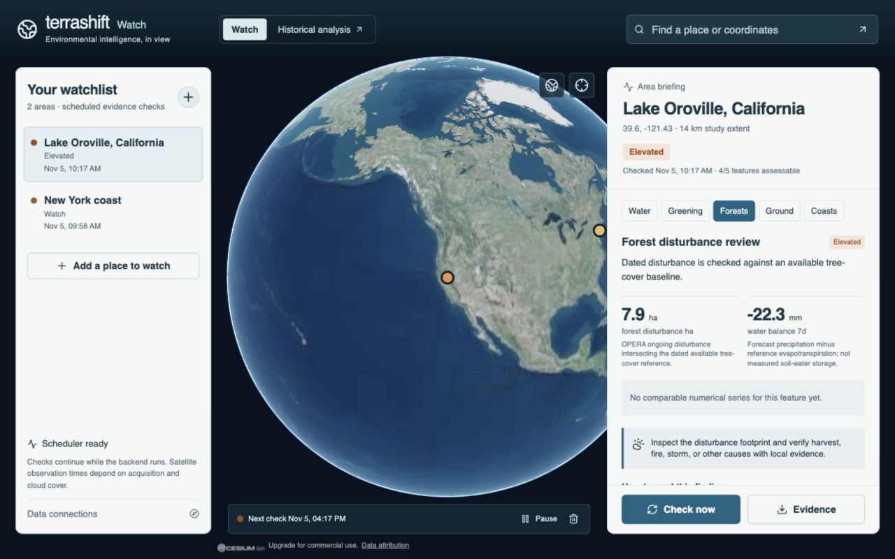
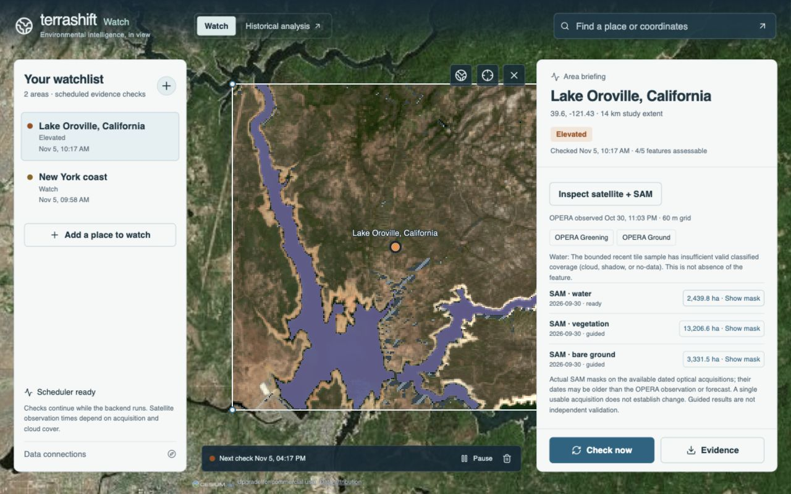
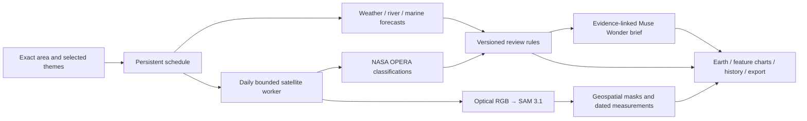

# Terra Shift Watch

**Keep the places that matter in view.**

Terra Shift Watch brings satellite observations, environmental forecasts, and evidence-linked AI explanations into one interactive Earth. Draw an exact boundary, choose the questions that matter, and keep returning to a record of what changed and what deserves closer attention.

Environmental damage is often understood too late. This project’s ambition is to help communities protect lives, livelihoods, and ecosystems by making environmental evidence easier to inspect and act on. It supports investigation and earlier review; it does not claim proven lives saved or avoided disaster losses.



[Explore the methods](docs/watch-methods.md) · [Verification record](docs/watch-verification.md) · [Original Terra Shift](https://github.com/StartZer0/terra-shift)

## From looking back to keeping watch

The historical observatory answers **“What changed here?”** Watch adds **“What should we review next?”**

- **Exact areas:** search by place or coordinates, select a square with a chosen width, or draw and edit a polygon on the 3D globe. Satellite measurements follow that boundary. Weather and river forecasts represent nearby model grid cells, with their offsets shown.
- **Several investigations at once:** Water, Greening, Forests, Ground, and Coasts each have their own finding, evidence, chart, limitations, and suggested next action.
- **Persistent monitoring:** save up to twelve areas, schedule checks every six hours, twelve hours, or daily, pause/resume them, and inspect the recent priority history. Overdue enabled checks resume after backend restart.
- **Seven-day outlook:** inspect rainfall, atmospheric drying pressure, modeled river discharge, and coastal wave forecasts. Forecast dates are visibly shaded in the charts.
- **Evidence from orbit:** read recent NASA OPERA water and disturbance classifications inside the selected area. Inspect actual optical acquisitions with Meta SAM 3.1 and place the resulting masks on Earth.
- **Daily satellite inspections:** enable bounded daily OPERA and SAM checks for each area. Acquisition gaps, clouds, and missing coverage remain visible.
- **Traceable explanations:** Muse Wonder turns supplied evidence into a readable briefing. Numerical measurements and priority levels remain controlled by the analytical pipeline.
- **Portable evidence:** download JSON containing the area, sources, methods, snapshots, and evidence references. No API credentials are included.

### What the levels mean

**Routine → Watch → Elevated → High review priority** are transparent application rules for deciding what deserves review. **Unknown** is a separate state. These levels are not official warnings, validated disaster probabilities, or assurances of safety.

| Investigation | Evidence used | What it can tell you |
| --- | --- | --- |
| Water | Forecast river discharge, recent modeled context, rainfall, dated OPERA water masks | Unusual modeled flow, heavy-rain review signals, and observed water-area change where two comparable rasters exist |
| Greening | Forecast precipitation minus reference evapotranspiration; observed vegetation disturbance | Atmospheric drying pressure and dated disturbance, with their different meanings kept separate |
| Forests | OPERA vegetation disturbance intersected with an available dated tree-cover reference | Disturbance within the covered reference; missing or insufficient baseline means Unknown |
| Ground | Weather drying pressure and generic observed disturbance | Conditions or mapped changes worth investigating; no inferred desert-expansion or erosion rate |
| Coasts | Nearby significant-wave-height forecasts | Wave-exposure review signals; no storm-surge depth or predicted shoreline retreat |

## Meta AI is part of the evidence pipeline

### SAM 3.1: actual masks on actual imagery

SAM receives calibrated RGB satellite previews with text concepts such as water, vegetation, and bare ground. The integration parses the model’s native segmentation stream, decodes masks, checks geometry, clips results to valid geospatial support, and converts pixels into hectares in an equal-area projection.

An empty response is not treated as proof that an object is absent. The pipeline can make one bounded recovery pass using spectral candidate regions as geometric prompts. Those masks are explicitly labeled **guided**: agreement with the spectral layer is not independent accuracy. Missing masks remain gaps. A single usable acquisition cannot establish a change rate.

The same integration remains available in the historical workspace, including interactive point refinement, dated segmentation histories, and gain/loss overlays.



### Muse Wonder: interpretation with an evidence contract

The server uses **Muse Wonder** with maximum reasoning effort to explain the combined assessment. Every briefing must cite existing evidence IDs, pass a structured response schema, and avoid invented numerical claims. One bounded correction is allowed; if validation fails, the measured findings remain available without an AI explanation.

Model IDs are configurable, with `muse-wonder-1.0` and `sam-3.1` as the defaults. Requests run server-side and carry `store: false`. Provider retention remains governed by the provider’s terms. The app records model/request provenance and estimated usage locally; the README makes no claim that Muse authored the code.

## Engineering behind the interface



The browser handles interaction and compact previews. Raster processing runs in isolated Python subprocesses. Cloud-optimized raster windows, fixed grid limits, nearest-neighbor handling of classified rasters, explicit valid coverage, serialized satellite work, subprocess timeouts, and a persistent estimated-spending ledger keep the workflow bounded.

Direct authenticated Copernicus EWDS/GloFAS and Marine reads are available as separate cross-checks. Queued EWDS jobs do not block the faster forecast assessment. A direct control forecast is not presented as an ensemble probability.

SQLite stores watch settings and compact evidence histories, capped at ninety snapshots per area. Raw satellite arrays and source RGB files are removed after inspection; current map previews expire after twenty-four hours. Deleting an area removes its local history and previews. Historical analysis jobs retain their separate idle and lifetime cleanup.

## Run locally

Requires **Node.js 22**, **Python 3.12**, and **FFmpeg** for historical video export.

```sh
git clone https://github.com/StartZer0/terra-shift-watch.git
cd terra-shift-watch
python3.12 -m venv .venv
.venv/bin/pip install -r requirements.lock.txt
npm ci
cp .env.example .env
chmod 600 .env
```

Fill the required values in `.env`, then start both services:

```sh
sh scripts/start-local.sh
```

- **Watch:** http://127.0.0.1:5174/
- **Historical analysis:** http://127.0.0.1:5174/history
- **Local API:** http://127.0.0.1:8018/docs

### Accounts and keys

| Setting | Purpose |
| --- | --- |
| `MODEL_API_KEY` | Meta SAM and Muse requests; needed for AI features |
| `VITE_CESIUM_ION_TOKEN` | Restricted public Cesium read/geocode token; the only browser-visible token |
| `EARTHDATA_TOKEN` | Authenticated NASA OPERA raster reads; catalog discovery is public |
| `EWDS_API_KEY` | Optional direct GloFAS cross-check; accept the relevant CEMS dataset licence in your own account |
| `COPERNICUSMARINE_SERVICE_USERNAME` / `COPERNICUSMARINE_SERVICE_PASSWORD` | Optional direct Marine cross-check |

Public weather, river, marine fast feeds, and satellite catalog discovery do not require an application key for this local research setup. Respect each service’s terms and limits. Configured credentials are not proof of product availability in every selected area.

`.env`, `.runtime`, downloaded data, local environments, and dependency folders are ignored by Git. Never put private keys in a `VITE_` variable. `META_SESSION_BUDGET_USD=15` sets the local persistent estimated-spend ceiling; it does not measure account-wide spending. Daily SAM and scheduled Muse briefings consume credits.

The current build binds to localhost. **Checks run only while the backend is running and the computer is awake.** Unattended operation needs an always-on host, durable storage, service supervision, user authentication, and deployment security. This repository is not a public multi-user alert service.

## Historical workspace included

The `/history` route preserves the original exact-area investigation workflow: Landsat histories reaching back to 1982 where available, Sentinel-2, catalog-specific HLS, MODIS, and Sentinel-1 radar alternatives; annual composites, feature-specific change maps, SAM inspection, and complete yearly GIF/MP4 exports with missing years disclosed.

[Watch the original 2:59 historical-analysis demonstration](https://youtu.be/ydVXJTPAcGI). That video demonstrates the original Terra Shift, rather than the Watch features introduced here.

## Verification and scope

The API suite covers numerical support, missing/stale data, geometry, source isolation, persistence, deletion, SAM response handling, single-acquisition limits, bounded scheduling, and Muse evidence validation. See the [verification record](docs/watch-verification.md) for commands and real provider checks.

```sh
.venv/bin/python -m pytest services/api/tests -q
npm run build
```

Watch monitors **registered areas**, rather than continuously scanning every pixel on Earth. OPERA coverage, optical cloud gaps, reference dates, grid resolution, forecast uncertainty, and data-service latency limit what can be concluded. The next step toward operational hazard prediction is validation against independent events and expert-reviewed hazard models, not an LLM-generated probability.

## Relationship to the submitted project

This independent continuation was developed beginning **November 5, 2026**, from the original Terra Shift revision [`6f14bd9`](https://github.com/StartZer0/terra-shift/commit/6f14bd9). The submitted repository remains separate. New Watch commits use their actual development timestamps.

## Data credits

[NASA OPERA](https://nasa-opera.github.io/docs/products/), [NASA Earthdata](https://www.earthdata.nasa.gov/), [Open-Meteo weather](https://open-meteo.com/en/docs), [GloFAS flood API](https://open-meteo.com/en/docs/flood-api), [marine forecast API](https://open-meteo.com/en/docs/marine-weather-api), [Copernicus EWDS](https://ewds.climate.copernicus.eu/datasets/cems-glofas-forecast), [Copernicus Marine](https://marine.copernicus.eu/), [Microsoft Planetary Computer](https://planetarycomputer.microsoft.com/), USGS Landsat, Copernicus Sentinel, NASA MODIS/HLS, and the University of Maryland tree-cover reference. Individual data licences and attribution requirements continue to apply. Cesium supplies the interactive Earth; Meta models supply segmentation and evidence-linked language interpretation.
