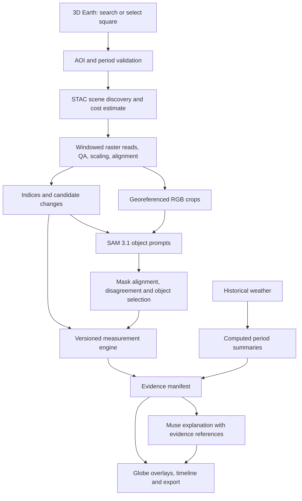

# System architecture

## Components and ownership

- **Web:** React + TypeScript + Vite, CesiumJS for navigation and georeferenced layers; a compact chart library for timeline/weather. A dedicated client app avoids server-rendering complexity around WebGL.
- **API and worker:** Python FastAPI, Pydantic contracts, rasterio/GDAL, NumPy, pyproj, shapely, pystac-client, planetary-computer. Add xarray only if temporal cubes warrant it. Pin versions after a working installation.
- **Jobs:** session-scoped SQLite metadata and a single bounded worker process for the hackathon; on-disk active-job tracking, cancellation and idempotent stage outputs. On restart, purge orphan run files rather than preserve historical studies. Do not perform raster jobs synchronously in HTTP request handlers. Redis/Celery are unnecessary for the first deployment.
- **Artifacts:** run-specific temporary storage only. Delete raw source imagery after processing; keep derived previews/masks/metrics only until settings change, expiry or explicit deletion. Browser receives temporary tiles/images/vectors, not whole multispectral scenes. No cross-analysis imagery cache or saved-study archive. Follow `07-temporary-storage.md`.
- **Meta adapters:** SAM segmentation and Muse narrative use server-only API calls. Muse Code is the development tool, not part of every user request.
- **Deployment:** local frontend and Python API first; for later public deployment, a frontend static host plus a Python-capable service; Modal is a candidate for the latter only after confirming the actual provider and credits. Baseten inference is optional and does not replace raster processing.

Optional Sentinel-2, Sentinel-1, HLS and MODIS source adapters are included in the requested source-selection scope; each needs its own QA, method and coverage policy. Follow `08-performance-and-source-options.md` for bounded CPU/memory/disk use, source differences and browser rendering budgets.

No fine-tuning or self-hosted GPU is necessary for the proposed Meta API path. Satellite processing is primarily CPU, memory and I/O work.

## AOI and global navigation

Search and click must resolve to the same AOI state. Longitude/latitude inputs are always supported. Draw a square with a center and side length measured in meters in a local projection, then transform its boundary to WGS84. Do not use equal degree increments and call them a physical square.

Handle antimeridian selections by splitting search geometry and preserving one logical AOI. Use a suitable polar/local projection at high latitudes. The globe can navigate everywhere; land-imagery coverage and detector suitability are evaluated after selection. Ocean-only, invalid-date and unobservable regions receive specific explanations.

Starting proposal: 10 km square at native analysis resolution, configurable up to 100 km per interactive job subject to a pixel/scene budget. Larger squares remain selectable and receive a tiled-job estimate or a choice of coarser resolution; never silently shrink the area or resolution. Default caps are operational policies, not a limit to a single demo location.

## Provider selection and year-range policy

**Decision: Landsat Collection 2 Level-2 surface reflectance is the default for year-range analysis.** Use Planetary Computer STAC `landsat-c2-l2`, subject to verified asset reads. This supports a requested interval such as 2000–2020 without switching the later years to Sentinel. Sentinel-2 L2A is an optional higher-detail mode for periods from 2015 onward where local coverage permits; compare the full requested period within that declared source policy.

The UI accepts inclusive start/end years, e.g. 2000 through 2020, and a seasonal window. This requests 21 annual summaries, not just two endpoint images. Validate start ≤ end and collection/site coverage. Retrieve suitable observations for each year, compute quality-screened seasonal summaries and publish the usable-observation count and missing years. Display endpoint change and the supported annual trajectory/rate separately. A requested year with inadequate evidence remains missing, not zero or a fabricated interpolation.

Landsat is a mission family, not one unchanged sensor: 2000–2020 spans Landsat 5/7/8. Use a documented preference policy (Landsat 5 while available, Landsat 8 for its later record, Landsat 7 only as a flagged supplement when appropriate), semantic band mapping, sensor-specific QA, correct scales/offsets, and explicit cross-sensor consistency checks. Treat Landsat 7 scan-line gaps as missing data. A common 30 m grid alone is not harmonization. Store sensor composition per year, flag sensor-transition uncertainty, and withhold strong trend interpretations if consistency is not established. Do not assume a published correction transfers unchanged to our product/region.

Discover item assets and scale metadata dynamically, then map them to semantic bands in a tested adapter. Use server-side signing as needed. Record asset IDs in the active manifest, not expiring tokens; discard the manifest with the analysis unless the user exports it. Verify a range read before committing to a provider.

Earth Search is an alternative adapter, not an automatic source switch mid-series. Different catalog processing/scaling can introduce false changes. A source change requires provenance and consistency checks. HLS is optional for a separately tested recent-history policy and cannot satisfy 2000–2020.

Process years in bounded batches and delete raw source windows after deriving each year's needed outputs. Retain only active-analysis derivatives until confirmed settings replacement or expiry, following document 07. The total workload depends on AOI size, number of years and scene availability; do not promise instantaneous processing for arbitrary selections.

## API contract proposal

| Endpoint | Purpose |
|---|---|
| `GET /api/capabilities` | Enabled modules, model availability, source/date coverage, job limits |
| `POST /api/scene-search` | Validate AOI/windows; return candidate scene metadata and expected support |
| `POST /api/analyses` | Validate request, create immutable configuration and enqueue job |
| `GET /api/analyses/{id}` | State, progress stages, warnings, artifact references and usage |
| `POST /api/analyses/{id}/cancel` | Cooperative cancellation; no further provider calls |
| `DELETE /api/analyses/{id}` | Invalidate generation, cancel and purge current analysis |
| `GET /api/analyses/{id}/artifacts/{name}` | Controlled access to image/raster/vector/report artifacts |
| `POST /api/analyses/{id}/regions` | User selection/correction; create a version, never overwrite evidence |
| `POST /api/analyses/{id}/explanation` | Generate narrative from the stored evidence manifest |
| `GET /api/analyses/{id}/export` | Bundle configuration, observations, maps, metrics and provenance |

Request fields: schema_version; AOI GeoJSON plus center/side_m; temporal_mode; before/after windows or year range/season; requested modules; source policy; processing resolution; threshold policy version; SAM policy; weather policy. Use UTC timestamps and ISO dates. Reject incompatible combinations with actionable errors.

Result fields: job_id; config_hash; status; actual scenes; common valid area; per-period observation counts; measured metrics with units; observed change classes; interpretations with evidence/limitations; SAM contribution and failures; weather source/grid/baseline; artifact refs; manual corrections; runtime/usage; method_version; source attributions; generation; expires_at; raw_sources_deleted; cleanup_status.

Metrics require `id`, `value` (nullable), `unit`, `support_area_ha`, `method`, `evidence_ids`, and `unavailable_reason`. Missing data is not a zero. Results can be partial without implying that unavailable modules succeeded.

Job states: queued → discovering → downloading → preprocessing → measuring → segmenting → summarizing → complete. Additional states: needs_input, insufficient_data, partial, failed, cancelled, cleaning, cleanup_failed, deleted, expired. Stage timings are real; do not fabricate progress percentages or mark completion before artifacts are committed.

## Narrative contract

Muse receives validated metrics, scene metadata, computed weather anomalies, quality flags and allowed labels. Optional reference crop(s) aid explanation but do not supersede measurements.

Return structured claims: text, metric/evidence IDs, observation-or-interpretation type, and limitations. Validate numbers against stored values and units before rendering. Reject invented percentages, dates, causation, unsupported disaster labels and confidence probabilities. Use a deterministic summary template if generation fails. Do not expose arbitrary database queries or shell execution to the narrative model.

Example structure, not a real finding: “Within the comparable observed area, mapped water decreased by {net_loss_ha} hectares between {date0} and {date1}. {invalid_pct}% of the selected square could not be compared. This observation does not measure water volume.”

## Reliability and access controls

Use provider allowlists for remote raster URLs; never fetch an arbitrary user URL from the backend. Limit geometry, pixel count, scene count, date range, per-job concurrency and output size. Apply timeouts/retries with backoff, cancellation and request deduplication. Reject stale or cross-job geometry references. Escape all model-provided text; do not render raw HTML.

Runtime model keys stay server-side. Cesium gets a dedicated public read/geocode token restricted to permitted URLs/assets, not a private management token. Keep attribution visible. A public demo must have bounded server-side usage; a client-side counter is not a budget control.

## Spending plan

User-reported balances: Meta $150, Baseten $100, provider described as Model.com $30 (likely Modal, not yet confirmed).

Proposed Meta ceilings: coding $75, SAM/narrative smoke checks and evaluation $25, demo reserve $50. These are spending limits, not a claim that the workload fits. Read current provider pricing before paid calls and record actual response usage. Deduplicate identical in-flight SAM requests only within the same active run. Purge their outputs with that run; no cross-analysis reuse after settings changes.

At documented SAM pricing of $2.50/1,000 images, two dates × two concepts × 16 tiles is 64 image requests, approximately $0.16 for SAM alone. Image tiling limits, retries, Muse usage, data transfer and hosting are additional. An entire planet or a 20-year high-resolution series is not comparable to that small job.

Do not force Baseten into the pipeline for sponsor coverage. If used, specify an accessible Meta open-weight model and an actual role, with its own evaluation. Never assume credits transfer between providers or cover every product.
