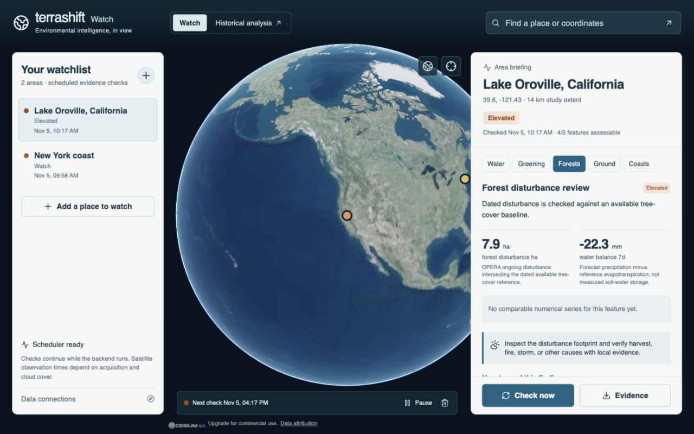
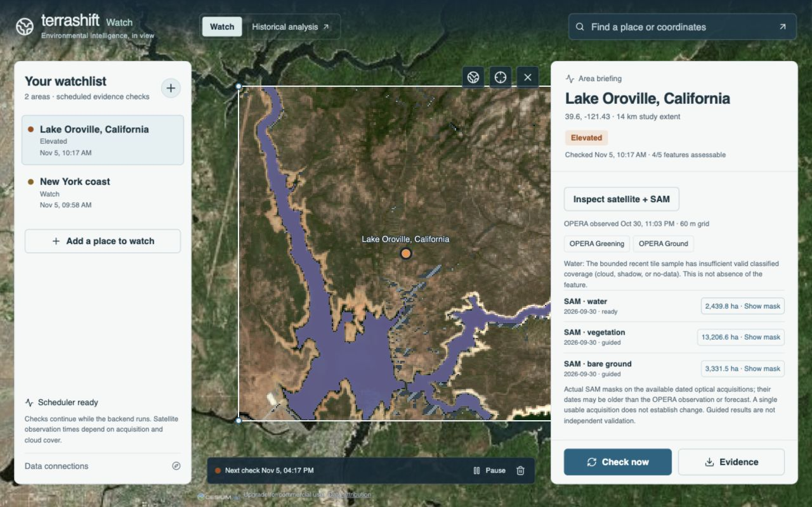
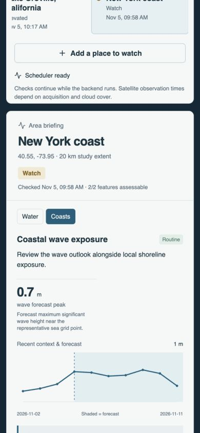

# Verification record — November 5, 2026

This records checks of the separate Watch continuation. It is implementation verification, not independent validation of hazard forecasts.

## Automated checks

- `.venv/bin/python -m pytest services/api/tests -q`: **50 passed**. Two upstream deprecation warnings (Starlette/httpx TestClient and Planetary Computer Pydantic configuration).
- `npm run build`: TypeScript and Vite production build. Cesium produces a large lazy-loaded globe chunk; the bundle-size advisory remains.
- Premium UI static audit in strict mode: **zero errors, zero warnings**.
- Official `@google/design.md` lint: zero errors; twelve advisory warnings because CSS-owned palette tokens are not expressed as component references in the frontmatter. Runtime token ownership is documented in `DESIGN.md`.
- `npm ci`: locked frontend dependencies installed independently; registry audit reported no known vulnerabilities at installation time. This is not a complete security audit.

Tests cover source/date/resource contracts inherited from historical analysis, mask decoding and invalid geometry, bounded guided recovery, common support, missing years, a single usable SAM date, no usable optical dates, review-rule input limits, stale forecasts, forest-reference support, persistence and history retention, failed-check backoff, derived-update scheduling, API deletion and private-value exclusion, and invalid Muse outputs.

## Real provider checks

All calls used configured local server-side credentials; credential values and raw authenticated responses are excluded from this repository.

| Component | Result |
| --- | --- |
| Open-Meteo weather and GloFAS fast feed | Live seven-day forecast and recent river context returned for Lake Oroville |
| Open-Meteo coastal forecast | Live wave forecast returned for the New York coastal selection |
| NASA CMR | Recent OPERA water and disturbance product records discovered |
| NASA authenticated raster reads | Actual windowed raster reads succeeded after resolving signed Earthdata CDN redirects without forwarding the bearer token |
| OPERA near Lake Oroville | Recent vegetation and ground disturbance rasters measured; bounded water candidates had insufficient valid classified coverage, correctly retained as unavailable |
| SAM 3.1 | Actual dated optical image segmented: water returned directly, vegetation and bare ground returned through labeled geometric guidance |
| SAM temporal support | Only one usable optical acquisition in the sampled windows; no SAM change or change rate inferred |
| Forest context | Dated tree-cover reference intersected with ongoing observed disturbance; feature-specific evidence rendered |
| Muse Wonder | Real structured briefing returned and passed evidence-ID/schema validation for the New York coastal selection |
| Copernicus Marine direct | Authenticated wave dataset read returned daily forecast values |
| Copernicus EWDS direct | Account and existing CEMS-FLOODS licence confirmed read-only; bounded forecast retrieval at a Lower Indus river location returned seven control-forecast discharge values |
| EWDS coastal missingness | A successful authenticated request at the New York coastal point had no usable river cell; retained as no-data rather than interpreted as a login failure |

The single usable SAM acquisition was September 30, while the OPERA observation was October 30. The application displays those different dates. Neither is portrayed as a current real-time photograph.

## Browser checks

The actual running application was exercised at 1280 × 800 and 390 × 844:

- Create areas with several selected themes, search by coordinates, and use the exact-area controls.
- Switch findings and verify distinct numerical evidence and chart support; inland coastal evidence remains Unknown.
- Run satellite/SAM inspection and place a returned mask on the globe.
- Request and inspect a Muse briefing and direct Copernicus cross-checks.
- Enable daily satellite inspection, pause/resume checks, open deletion confirmation, and dismiss it using Escape without deleting the saved watch.
- Restart the Watch backend and confirm both saved areas persist.
- Check responsive document flow and horizontal bounds: 390 px viewport and 390 px document/body width.
- Inspect browser console after the working flow: no warnings or errors recorded.

A notification initially overlapped scheduling controls on desktop. It was moved above those controls; narrow layouts render notifications in document flow. Saved screenshots are genuine application captures, not fabricated sample reports.

## Practical limits

No independent flood-event backtest, calibrated event probability, sensor ground-truth campaign, full screen-reader audit, long-duration uptime test, or deployment load test has been performed. The forecast and satellite services can be late or unavailable. OPERA coverage is not worldwide; arbitrary selected areas may lack suitable evidence. Forest reference age limits attribution. The scheduler runs only with the backend awake and running.

The original submitted repository was kept separate at revision `6f14bd9`. The Watch repository starts a new history with actual development timestamps.
